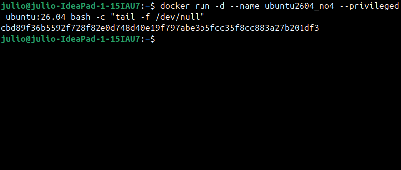
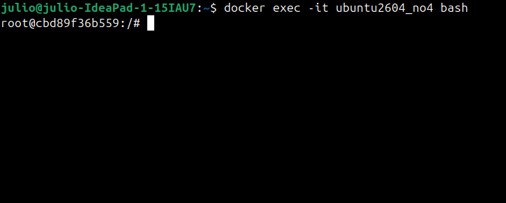
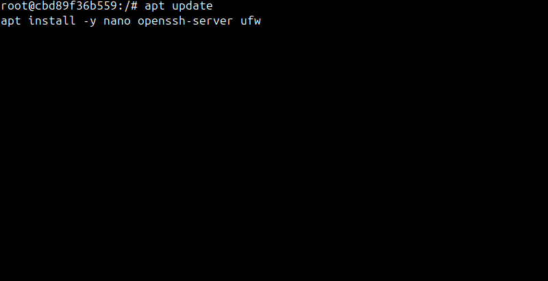
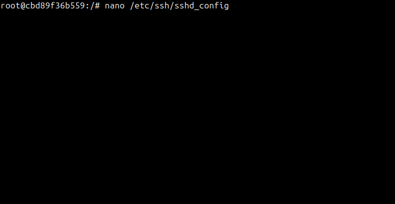
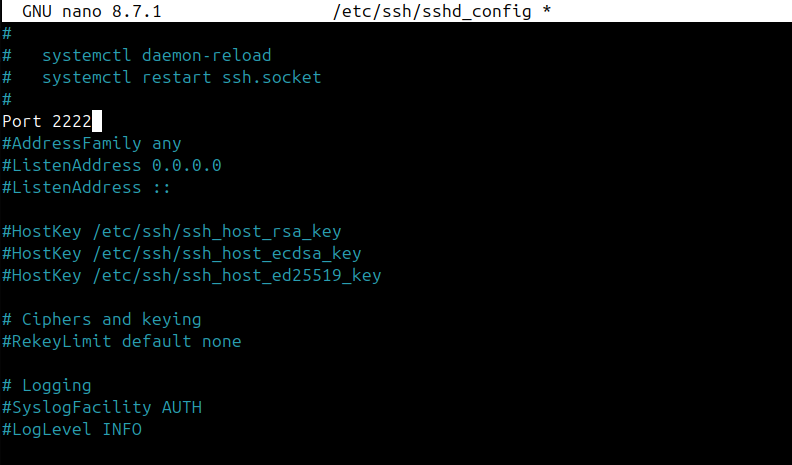
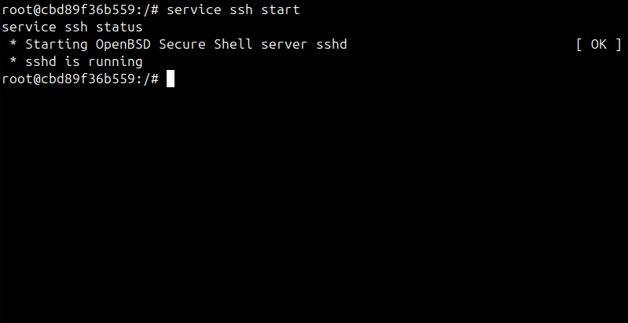
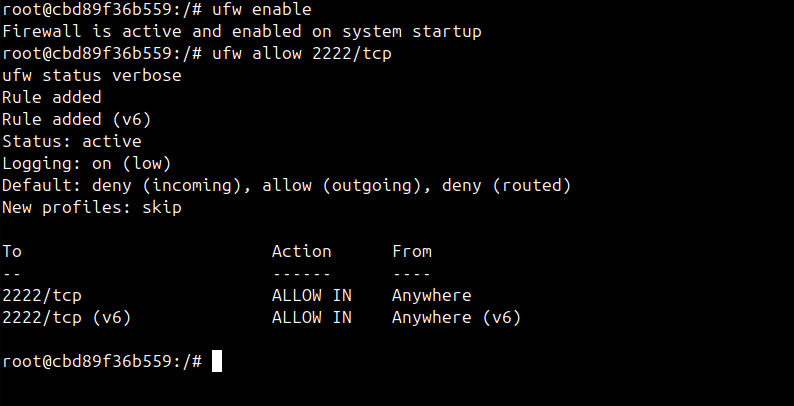
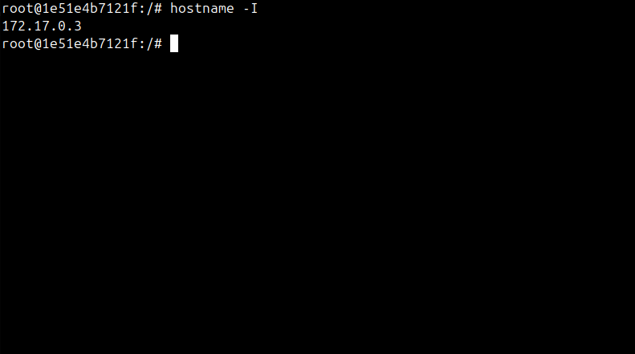
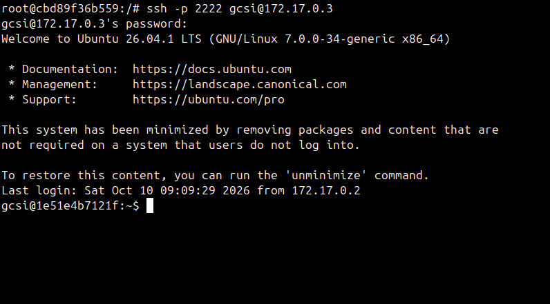

# Atividade 1 - Documentação para configuração de Acesso remoto e Firewall (SSH e UFW)

**Disciplina:** Gerência e Configuração de Serviços para Internet (GCSI)  
**Aluno:** Júlio Soares da Silva   
**Ambiente:** Docker com imagem Ubuntu 26.04 LTS

---

### Passo 1: Criação e Configuração do Nó 1 (`ubuntu2604_no4`)

Para iniciar, criamos o container do primeiro nó. Foi utilizada a flag `--privileged` para que o container tivesse permissão de manipular as regras de firewall (iptables) do sistema.

```bash
docker run -d --name ubuntu2604_no4 --privileged ubuntu:26.04 bash -c "tail -f /dev/null"
```


Em seguida, acessamos o terminal do container como root:

```bash
docker exec -it ubuntu2604_no4 bash
```


---

### 1.1. Instalação dos pacotes necessários

Atualizamos os repositórios e instalamos o `nano` (editor de texto), `openssh-server` (servidor SSH) e `ufw` (firewall).

```bash
apt update
apt install -y nano openssh-server ufw
```


---

### 1.2. Configuração do SSH

Editamos o arquivo de configuração do SSH para alterar a porta padrão (22) para a porta 2222, visando maior segurança e evitando conflitos.

```bash
nano /etc/ssh/sshd_config
```


> **Nota:** A linha `#Port 22` foi alterada para `Port 2222`.



Após salvar, iniciamos o serviço SSH e verificamos seu status:

```bash
service ssh start
service ssh status
```


---

### 1.3. Configuração do Firewall (UFW)

Ativamos o firewall e liberamos a porta 2222 (TCP) que configuramos no SSH.

```bash
ufw enable
ufw allow 2222/tcp
ufw status verbose
```


---

### Passo 2: Criação e Configuração do Nó 2 (`ubuntu2604_no5`)

**Repita os mesmos passos do Nó 1 para criar e configurar o segundo container.**
*Substitua o nome `ubuntu2604_no4` por `ubuntu2604_no5` no comando `docker run`.*

Após a criação, acesse o `ubuntu2604_no5` e descubra o seu endereço IP:

```bash
hostname -I
```


**(Neste exemplo, o IP retornado foi `172.17.0.3`)**

Ainda no `no5`, crie o usuário `gcsi` e defina uma senha para ele, utilizamos uma senha simples para fins de teste:

```bash
useradd -m -s /bin/bash gcsi
passwd gcsi
```

---

### Passo 3: Teste de Acesso Remoto (SSH)

Com os dois nós configurados, voltamos para o terminal do **Nó 1 (`ubuntu2604_no4`)** e realizamos a conexão SSH com o **Nó 2 (`ubuntu2604_no5`)** utilizando o IP obtido no passo anterior.

```bash
ssh -p 2222 gcsi@172.17.0.3
```



**Resultado:** O prompt mudou para `gcsi@1e51e4b7121f:~$`, confirmando que o acesso remoto entre os containers foi estabelecido com sucesso através da porta 2222, respeitando as regras do firewall (UFW).
